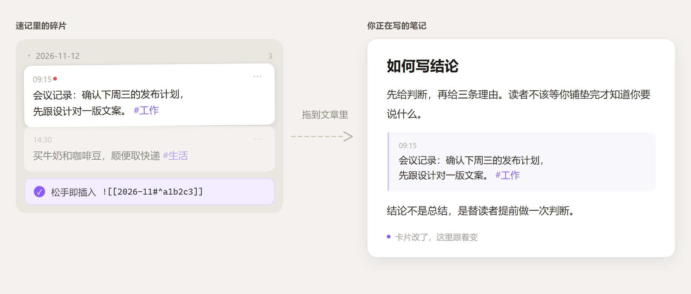

# Collis

**Obsidian 速记卡片：不用建文件，`Ctrl+Enter` 记一张，纯 Markdown 存在你自己的库里。**

中文 · [English](#collis-quick-cards-for-obsidian)


*侧边栏输入框常驻；`Ctrl+Enter` 存下后成为一张带时间的卡片，被别的笔记引用时右上角亮起红点。*

## 它是什么

Collis 是 Obsidian 的速记卡片插件。侧边栏常驻一个输入框，也可以按 `Ctrl/Cmd+J` 在任何页面唤出悬浮输入框；写完按 `Ctrl+Enter`，内容作为一张带时间的卡片写进当月的 Markdown 文件。

记录一张卡片不需要新建文件、不需要起标题、不需要选文件夹，也不打标签就能先存下来。

卡片是标准的 Markdown 列表项，存在库内文件夹（默认 `00-Inbox/速记/`），每月一个 `YYYY-MM.md`。插件离线运行、不联网、不采集数据；停用或卸载插件后，笔记原样保留。

## 核心特点

| 特点 | 具体是什么 |
| --- | --- |
| **低摩擦记录** | 侧边栏常驻输入框，`Ctrl/Cmd+J` 全局唤出，两个键存下一张卡片 |
| **选中即存** | 任意笔记里选中一段，`Ctrl/Cmd+Shift+C` 或右键「存为卡片」，只存文字、不写来源链接 |
| **多行原样保留** | 换行写成缩进续行 + 硬换行，卡片视图与阅读视图都保持原分行 |
| **本地纯 Markdown** | 按月一个文件，无私有格式、无自带云同步，卸载插件内容不动 |
| **全库检索** | 跨所有月份，按标签、日期、时间、短语、关键词筛选且可叠加 |
| **写的时候随时调用** | `Ctrl/Cmd+Shift+K` 打开卡片面板，搜关键词、`#标签`、日期；`Enter` 插引用，`Shift+Enter` 插原话 |
| **卡片可用于写作** | 卡片拖进笔记即成引用，也可从菜单复制 `![[文件#^id]]`；卡片改动，引用处同步 |
| **被引用看得见** | 被引用时右上角红点提示；菜单里一行「被 N 篇笔记引用…」，点开列出全部引用，任选一条跳到引用位置 |
| **误删可恢复** | 二次确认、9 秒撤销、最近删除 50 条；手写时间行不会被当成卡片 |

## 功能明细

### 记录

- **侧边栏输入框**：常驻在卡片视图顶部，输入框随内容自动长高（最高 200px 后内部滚动）
- **悬浮输入框**：`Ctrl/Cmd+J` 在任何页面唤出，`Esc` 关闭，不打断当前正在读或写的笔记
- **两个键完成记录**：`Enter` 换行，`Ctrl+Enter` 保存，内容落在当天日期下
- **选中即存**：在任意笔记里选中一段文字，`Ctrl/Cmd+Shift+C` 或右键菜单「存为卡片」，直接存成一张卡片，接着往下读就行。只存文字、**不带来源链接**——原文以后删了也不会留下死链；超过 300 字照存但会提示「偏长」。提示条 8 秒内可点撤销；手机上从工具栏调用同样有效（读最近一次选区）
- **快捷键可改**：`Ctrl/Cmd+J` 只是默认值（macOS 上是 `Cmd+J`，由 Obsidian 按系统解析），在 设置 → 快捷键 里搜索「快速记一条」「把选中的内容存为卡片」「插入卡片」即可更换；即使改了，命令面板里也仍能调用
- **草稿不丢**：关掉窗口、切走、保存失败，内容保留在插件数据文件里，下次打开自动填回，保留 7 天；开始编辑后提示自动收起
- **标签联想**：输入 `#` 弹出库内已有标签，按使用频率排序；`Tab` 或 ↑↓ + `Enter` 选中，直接按 `Enter` 仍是换行，不影响正常输入
- **常用标签快选**：悬浮窗口中可直接点常用标签填入

### 标签

- `#标签` 是 Obsidian 原生标签，标签面板、全局搜索、`tag:` 查询本来就能用
- `#父/子` 嵌套标签：标签栏把子标签聚合到父标签下，点父标签一次筛出整组
- 标签栏每个标签带卡片数量，「无标签」一键筛出还没打标签的卡片
- 标签栏可折叠，默认只显示前几组，尾部「更多 / 收起」，不挤压列表空间

### 搜索与筛选

不用回忆内容存放在哪，输入记得的部分即可：

| 你记得 | 就输入 |
| --- | --- |
| 标签 | `#工作` |
| 哪一天 | `11-07`、`2026-11` |
| 几点写的 | `13:41` |
| 一句话 | `"整句短语"` |
| 几个词 | 空格分开，须同时命中 |

- 搜索覆盖**所有月份文件**，不只当月
- 关键词、标签、日期、引用状态可叠加，叠加条件会在搜索框下方明示
- 日期标题可折叠，折叠状态记在设置里，重启后保留
- 「引用」按钮在 全部 → 已引用 → 未引用 之间循环，可与右上角红点对照

### 编辑与删除

- **双击即改**：双击卡片原地进入编辑，多行内容按行数自动展开，`Ctrl+Enter` 保存、`Esc` 取消；手机上双击同样有效
- **一次只改一张**：正在改一张时双击另一张，会先问「保存并继续 / 放弃修改 / 留在这条」，既不丢内容也不同时开两处编辑
- **右上「···」菜单**：复制全文、复制链接、编辑、被几篇笔记引用、在文件中定位、只看被引用的卡片、删除都收在这里，平时不占版面
- **删除**：菜单里二次确认后删除整张卡片（含所有续行）；被引用的卡片会先提示被几篇笔记引用
- **批量删除**：进入选择模式勾选多条，跨月份的一次处理完
- **撤销**：删除后 9 秒内可点提示条撤销；「最近删除」保留最近 50 条，可逐条恢复或清空
- **空标题清理**：某天卡片删空后，`## 日期` 标题一并移除；在编辑器里手删同样生效，光标所在日期段暂不处理
- **严格识别卡片**：默认开启，只有带块 ID（`^abc123`）的条目才算卡片。正文里手写的 `- 12:30 开会` 只是普通文字，不会出现在列表里，也不会被删

### 复制与引用



*按住卡片拖进笔记，松手落下的就是 `![[2026-11#^a1b2c3]]`；原卡片修改后，嵌入处同步更新。*

- **拖进笔记即引用**：按住卡片任意位置（不用找把手）拖到正在写的笔记里松手，落下的就是引用（与「复制链接」同一串），原卡片不受影响
- **复制全文**：卡片正文连换行、标签一并复制为纯文本，粘贴即见内容；不依赖块 ID，原卡片以后删掉，粘出去的文字也还在
- **复制链接**：默认 `[[2026-11#^a1b2c3]]`（点击跳转），可在设置里改为 `![[2026-11#^a1b2c3]]`（直接嵌入）；卡片没有块 ID 时会自动补上
- **被引用提示**：右上角小红点表示这张卡片被其他笔记引用过；「···」菜单里一行「被 N 篇笔记引用…」，点开是独立面板：每篇笔记的名字、所在文件夹、引用几处，点任意一条直接跳到**引用所在的那一行**；同名笔记会补上父目录标出来
- **写的时候调卡片**：`Ctrl/Cmd+Shift+K` 打开面板（和「快速切换」同一套壳），一行一张卡；没输入时列最近的卡片，输入后按关键词、`#标签`、`2026-11`、`"整句短语"` 筛选，字面不中时按字的重合度兜一层（搜「写作」也能找到含「写字」的卡），命中的字会标出来。`Enter` 插入 `[[文件#^id]]`，`Shift+Enter` 插入不带链接的原话
- **在文件中定位**：菜单里直接打开卡片所在的月份文件并选中那一行，不用自己翻
- **网址可点**：正文里的 `https://…` 点击直接用浏览器打开，长网址原位折行；`[[双链]]` 与 Markdown 语法不做解析，卡片内始终是纯文本
- **要选一段文字**：整张卡片可拖，所以想在卡内选中局部文字时，双击进编辑态再选

## 数据格式

```markdown
## 2026-11-06

- 09:15 会议记录：确认下周三的发布计划 #工作 ^a1b2c3
- 14:30 买牛奶和咖啡豆 #生活 ^d4e5f6
- 16:51 第一行内容  
  第二行内容 #示例 ^e7g8h9
```

- `- HH:mm 正文` 是卡片首行；换行写成缩进两空格的续行，行尾两个空格是 Markdown 硬换行
- `^a1b2c3` 是块 ID，固定在 Obsidian 认得的末行，让这张卡片可被双链和嵌入；它同时也是插件区分「卡片」和「手写时间行」的依据
- `#标签`、`#父/子` 都是原生标签
- 每月一个文件，避免单文件无限膨胀；停用插件、换编辑器、迁移库都不受影响

## 不适用的场景

- 不联网：没有自己的云同步，多端同步请用你已有的文件同步方案
- 不做富文本编辑：卡片内部是纯文本，Markdown 和双链不在卡片里渲染
- 不替代长文编辑：卡片用于碎片记录，成文仍应写在笔记里

## 安装

- **插件市场**：设置 → 第三方插件 → 浏览 → 搜索 **Collis** → 安装 → 启用
- **手动**：从 [最新 Release](https://github.com/R529/collis/releases) 下载 `main.js`、`manifest.json`、`styles.css`，放进 `<你的库>/.obsidian/plugins/collis/`（文件夹必须叫 `collis`），重启 Obsidian 后启用
- **BRAT**：命令面板执行 `BRAT: Add a beta plugin for testing`，输入 `R529/collis`

## 设置项

| 设置 | 说明 |
| --- | --- |
| 卡片文件夹 | 卡片存放位置，默认 `00-Inbox/速记`，不存在会自动创建 |
| 常用标签 | 逗号分隔，只影响候选排序；卡片里不存在的标签不会出现 |
| 最多渲染条数 | 只影响列表渲染性能，不影响搜索范围 |
| 自动清理空日期标题 | 默认开启。编辑器里手删同样生效，光标所在日期段暂时不动 |
| 严格识别卡片 | 默认开启。只有带块 ID 的条目才算卡片 |
| 块引用使用嵌入形式 | 关闭时复制 `[[文件#^id]]`（点击跳转），打开后复制 `![[文件#^id]]`（直接展开） |

## 兼容性与隐私

Obsidian 1.4.0 及以上，桌面端与移动端均可使用；旧版单行卡片格式完全兼容，升级无需迁移。插件完全离线运行，不联网、不采集数据、不需要账号，除插件自己的文件夹和数据文件外不写入任何位置。

MIT License，详见 [LICENSE](./LICENSE)。问题与建议：[GitHub Issues](https://github.com/R529/collis/issues)。

---

## Collis: quick cards for Obsidian

*[中文文档在上面](#collis)*

**Jot a card with `Ctrl+Enter` — no file, no title, no folder. Plain Markdown, stored in your own vault.**

### What it is

Collis is a quick-capture card plugin for Obsidian. A permanent input sits in the sidebar; `Ctrl/Cmd+J` opens a floating input from any page. `Ctrl+Enter` saves what you typed as a timestamped card in this month's Markdown file. No new file, no title, no folder, and no tag required.

Cards are ordinary Markdown list items stored in a folder you choose (default `00-Inbox/速记`), one `YYYY-MM.md` per month. The plugin runs fully offline and writes nothing outside your vault.

### Highlights

| Highlight | What it is |
| --- | --- |
| **Low-friction capture** | Permanent sidebar input, `Ctrl/Cmd+J` from anywhere, `Enter` for a new line, `Ctrl+Enter` to save |
| **Save a selection** | Select text in any note, press `Ctrl/Cmd+Shift+C` or right-click → Save as card; text only, no source link |
| **Multi-line kept intact** | Continuation lines are stored as indented lines with hard breaks, preserved in the card view and the reading view |
| **Plain Markdown, no lock-in** | One file per month, no private format, no own sync; any editor can open it, removing the plugin leaves your notes untouched |
| **Search across everything** | Every monthly file, filterable by tag, date, time, phrase or keyword, combinable |
| **Summon cards while writing** | `Ctrl/Cmd+Shift+K` opens a picker: search by keyword, `#tag` or date; `Enter` inserts a reference, `Shift+Enter` inserts the text |
| **Cards usable in writing** | Drag a card into any note to cite it, or copy `![[2026-11#^a1b2c3]]` from the menu; edit the card and every reference follows |
| **References you can see** | A dot marks a cited card; one menu entry opens a panel listing every citing note, and any row jumps to that exact line |
| **Deletion is reversible** | Confirmation, 9-second undo, last 50 deletions kept; only entries with a block ID count as cards |

### Capture

Permanent sidebar input that grows with the text (scrolls past 200px). `Ctrl/Cmd+J` opens a floating input on any page (`Cmd` replaces `Ctrl` on macOS, resolved by Obsidian itself), `Esc` closes it. `Enter` for a new line, `Ctrl+Enter` to save under today's date. Unfinished text is kept for seven days and restored next time.

Selecting text in any note and pressing `Ctrl/Cmd+Shift+C` (or right-click → Save as card) turns it into a card without leaving the note. Only the text is stored — no source link, so deleting the original later leaves no dead link. Selections over 300 characters still save, with a note that they are long, and the toast stays clickable for eight seconds to undo. On mobile the command falls back to your most recent selection, so tapping a toolbar button after the editor loses focus still works.

Type `#` for autocomplete over tags already in your vault, ordered by how often you use them; `Tab` or ↑↓ + `Enter` selects, a plain `Enter` still makes a new line.

### Tags

Native `#tag` and nested `#parent/child`, children grouped under their parent. Tag bar shows counts, has an "untagged" filter, and collapses to save space.

### Find

| You remember | You type |
| --- | --- |
| a tag | `#work` |
| a day | `11-07`, `2026-11` |
| a time | `13:41` |
| a sentence | `"a whole phrase"` |

Space-separated words must all match. Days collapse, and the collapsed state persists. The "Refs" button cycles all → cited → uncited, matching the dots on the cards.

### Edit and delete

Double-click a card to edit it in place (`Ctrl+Enter` saves, `Esc` cancels) — works on mobile too. Double-clicking another card while editing asks whether to save and continue, discard, or stay, so text is never lost and two edits never run at once. Everything else — copy as text, copy the link, edit, how many notes cite it, reveal it in its file, delete — sits in the `···` menu at the card's top right. Batch delete across months, 9-second undo, last 50 deletions kept, empty `## date` headings cleaned up automatically. Strict card detection means a hand-typed `- 12:30 standup` is never treated as a card.

### Copy and cite

Drag any part of a card into a note to drop a reference — no handle to aim at — or copy the card as plain text, or as `[[file#^id]]` / `![[file#^id]]` (configurable). A dot at the card's top right means other notes cite it; one menu entry — “cited by N notes” — opens a panel listing each citing note with its folder and how many times it cites the card, and any row jumps to that exact line. `Ctrl/Cmd+Shift+K` opens a picker (the same shell as Quick Switcher) with one card per row: recent cards before you type, then filtering by keyword, `#tag`, `2026-11` or `"a whole phrase"`, with a character-overlap fallback when nothing matches literally and the matched characters highlighted. `Enter` inserts `[[file#^id]]`, `Shift+Enter` inserts the text without a link. "Reveal in file" opens the month file with the line selected. If you need to select part of the card's text, double-click to enter editing first. Bare `https://…` is clickable; wikilinks and Markdown stay plain text.

### Data

```markdown
## 2026-11-06

- 09:15 Meeting notes: confirm next Wednesday's release plan #work ^a1b2c3
- 14:30 Buy milk and coffee beans #life ^d4e5f6
```

`^a1b2c3` is an Obsidian block ID kept on the card's last line. One file per month keeps any single file from growing without bound.

### Install

Settings → Community plugins → Browse → **Collis** → Install → Enable. Manual: drop the three release files into `<vault>/.obsidian/plugins/collis/`. BRAT: `R529/collis`.

### Settings

| Setting | What it does |
| --- | --- |
| Card folder | Defaults to `00-Inbox/速记`, created if missing |
| Common tags | Affects suggestion order only |
| Max cards rendered | Rendering limit only; search still covers everything |
| Clean up empty date headings | On by default, including manual deletions |
| Strict card detection | On by default; only entries with a block ID count |
| Block reference style | Off: `[[file#^id]]`. On: `![[file#^id]]` |

Requires Obsidian 1.4.0+, desktop and mobile, fully offline, MIT licensed.
